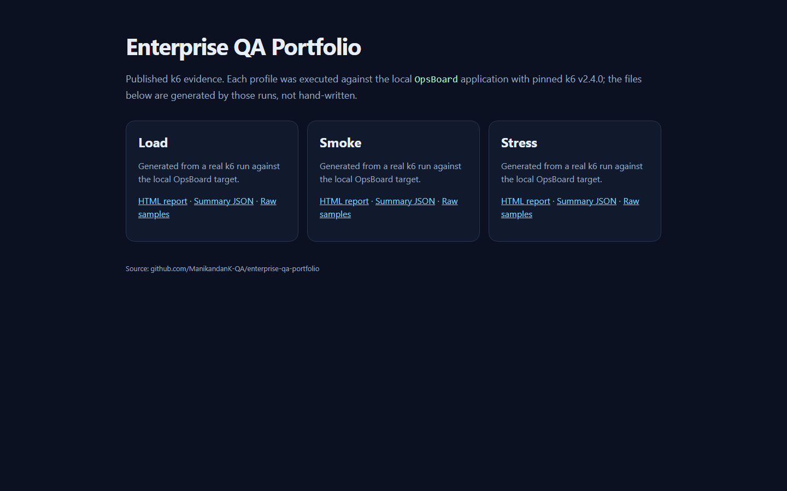

# Enterprise QA Portfolio

[](https://github.com/ManikandanK-QA/enterprise-qa-portfolio/actions/workflows/ci.yml)
[](https://k6.io/)
[](https://nodejs.org/)
[](LICENSE)

A small performance-engineering portfolio built around one rule: **a load test is
only credible when the system under test is controlled by the repository**. The
target here is OpsBoard, a local zero-dependency Node application with a fixed
dataset, explicit request latency and deterministic profiles. No public demo site,
random pacing or hand-written metrics are involved.

## What is demonstrated

- Three deliberately different k6 profiles: correctness smoke, ramped steady load
  and bounded peak stress.
- Shared checks, request tags and threshold definitions, so a profile only decides
  the shape of the load.
- Tag-filtered thresholds such as `http_req_duration{kind:api}` and
  `http_req_failed{expected:false}` — a planned 503 response is checked as an
  expected negative path, not silently counted as a production failure.
- A local `handleSummary()` that emits a JSON summary and a self-contained HTML
  report from the data k6 actually produced.
- CI that downloads all profile artifacts, builds one report site and publishes it
  to GitHub Pages.

## Repository layout

```
apps/opsboard/
  server.mjs                 zero-dependency local system under test
  public/                    dashboard, CSS and browser-side renderer

scripts/
  config.js                  base URL, run tags and request tag helpers
  checks.js                  reusable response checks
  summary.js                 handleSummary() -> JSON + HTML
  profiles/                  smoke.js, load.js, stress.js
  run-profile.mjs            starts target, preflights it, runs k6, cleans up
  build-site.mjs             combines published profile artifacts
  validate.mjs               offline quality gate

docs/
  architecture.md
  test-strategy.md
  ci.md
```

Full notes: [architecture](docs/architecture.md) ·
[test strategy](docs/test-strategy.md) · [CI](docs/ci.md) ·
[attribution](NOTICE.md).

## Quick start

Requirements: **Node 22+** and **k6 2.4.0**. k6 is not bundled or downloaded by
`npm install`; install it from the
[pinned release](https://github.com/grafana/k6/releases/tag/v2.4.0) and make sure
`k6 version` reports `v2.4.0`.

```bash
git clone https://github.com/ManikandanK-QA/enterprise-qa-portfolio.git
cd enterprise-qa-portfolio

npm run validate
npm run test:smoke
npm run test:load
npm run test:stress
```

Each `test:*` command starts OpsBoard on `127.0.0.1:8085`, waits for
`/api/health`, runs the k6 profile, writes evidence to `reports/` and then stops
the server. No ports need to be managed manually.

To serve the target without k6:

```bash
npm run serve
```

## Profiles

| Profile | Load shape | Purpose | Representative threshold |
| --- | --- | --- | --- |
| `smoke` | 1 VU, 12 iterations | Prove the target and checks work before load | `checks rate == 1`, failed requests `== 0` |
| `load` | 1 → 5 → 10 VUs, hold, ramp down | Steady-state behaviour under realistic concurrency | API `p(95) < 600 ms` |
| `stress` | 2 → 12 → 24 VUs, ramp down | Bounded peak with an abort guard | slow endpoint `p(95) < 1000 ms` |

Every profile also checks that response bodies contain the expected deterministic
data. A 200 with the wrong payload fails the run.

## Configuration

| Variable | Default | Purpose |
| --- | --- | --- |
| `BASE_URL` | `http://127.0.0.1:8085` | k6 target; normally left alone |
| `PORT` | `8085` | Port for the local target |
| `API_LATENCY_MS` | `8` | Deterministic API latency in the target |
| `SLOW_LATENCY_MS` | `25` | Deterministic latency of `/api/slow` |
| `K6_BIN` | `k6` | Path to the k6 binary if it is not on `PATH` |

The defaults are intentionally fast enough that a laptop can reproduce CI's
thresholds. Change latency only to study its effect, and record the values with
any result you publish.

## Evidence produced

For each profile:

- `reports/<profile>-raw.json` — raw samples from `--out json`.
- `reports/<profile>-summary.json` — machine-readable summary emitted by
  `handleSummary()`.
- `reports/<profile>-report.html` — HTML report rendered from the same summary.

CI combines those into a single Pages site. The live address will be linked here
after the first successful publication.

## Verified locally

| Check                                  | Result                                                   |
| -------------------------------------- | -------------------------------------------------------- |
| `npm run validate`                     | clean                                                    |
| `npm run test:smoke`                   | 102/102 checks, 39 requests, 6/6 thresholds in 2.9s      |
| `npm run test:load`                    | 4,936/4,936 checks, 1,998 requests, 8/8 thresholds in 35.3s |
| `npm run test:stress`                  | 7,530/7,530 checks, 3,012 requests, 9/9 thresholds in 20.1s |
| `SLOW_LATENCY_MS=1200 npm run test:stress` | correctly failed with exit 99; 8/9 thresholds         |

The negative control matters: raising the local slow-endpoint latency beyond the
documented budget breached only `http_req_duration{kind:slow}`. The green reports
below were regenerated with default latency afterwards.



## Verified in CI

| Check                                                   | Result                                            |
| ------------------------------------------------------- | ------------------------------------------------- |
| Quality gate                                            | passed                                            |
| Pinned k6 2.4.0 install and version guard on every job   | passed                                            |
| `smoke`                                                 | 102/102 checks, 39 requests, 6/6 thresholds       |
| `load`                                                  | 5,094/5,094 checks, 2,062 requests, 8/8 thresholds |
| `stress`                                                | 8,040/8,040 checks, 3,216 requests, 9/9 thresholds |
| Combined site and `gh-pages` publication                | passed                                            |

[Live report](https://manikandank-qa.github.io/enterprise-qa-portfolio/) ·
[CI run 45883366313](https://github.com/ManikandanK-QA/enterprise-qa-portfolio/actions/runs/45883366313)

The screenshot above was captured from the published Pages site. Each profile's
HTML report, summary JSON and raw k6 samples are also available from that site.

## Why this is original

The [grafana/k6](https://github.com/grafana/k6) repository and its examples were
studied for threshold, scenario and summary concepts. No upstream source was
copied. k6 itself is AGPL-3.0; see [NOTICE.md](NOTICE.md) for attribution.
